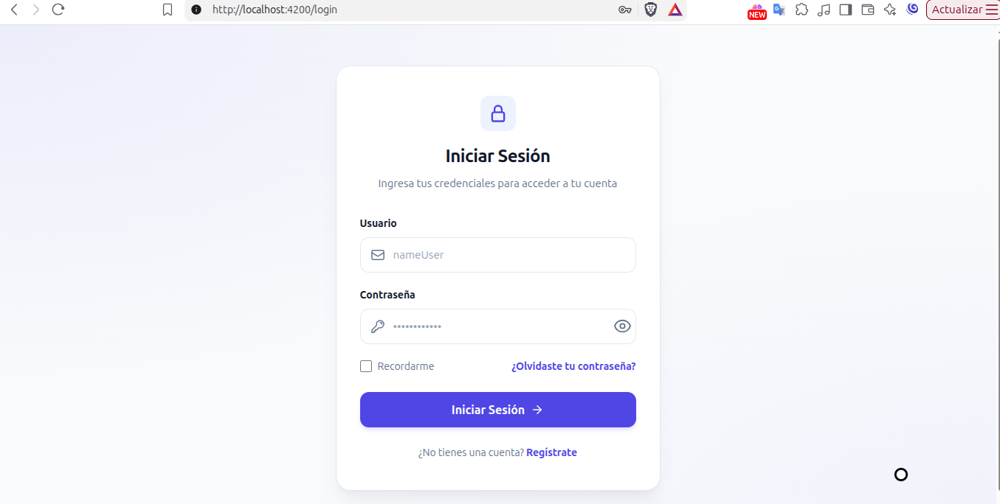
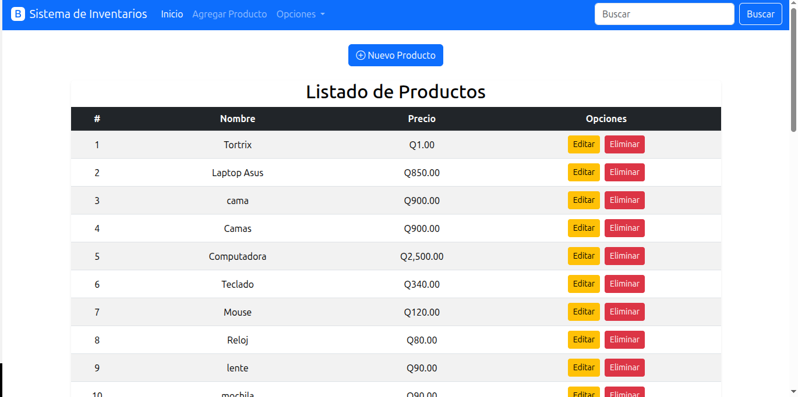

# 🧾 Sistema de Gestión de Inventarios

Aplicación **fullstack** de gestión de productos construida como proyecto de portafolio. Implementa un **CRUD completo** con validaciones, autenticación basada en **Spring Security + JWT** y una interfaz **SPA** reactiva en Angular.

El objetivo es demostrar buenas prácticas de desarrollo: arquitectura desacoplada, separación de responsabilidades, seguridad por roles, código limpio y documentación clara.

[]
[](https://spring.io/projects/spring-boot)
[](https://angular.dev/)
[](https://mariadb.org/)
[](https://jwt.io/)
[](./LICENSE)

---

## 📸 Vista previa

| Inicio de sesión                                  | Gestión de productos                     |
|:-------------------------------------------------:|:----------------------------------------:|
|  |  |
| Autenticación con JWT                             | CRUD de productos autenticado            |

---

## 📚 Tabla de contenido

- [Tecnologías y arquitectura](#-tecnologías-y-arquitectura)
- [Estructura del proyecto](#-estructura-del-proyecto)
- [Prerrequisitos](#-prerrequisitos)
- [Instalación y ejecución](#-instalación-y-ejecución)
  - [1. Clonar el repositorio](#1-clonar-el-repositorio)
  - [2. Configurar la base de datos](#2-configurar-la-base-de-datos)
  - [3. Ejecutar el backend](#3-ejecutar-el-backend)
  - [4. Ejecutar el frontend](#4-ejecutar-el-frontend)
- [Credenciales de acceso](#-credenciales-de-acceso)
- [Endpoints de la API](#-endpoints-de-la-api)
- [Seguridad](#-seguridad)
- [Buenas prácticas aplicadas](#-buenas-prácticas-aplicadas)
- [Solución de problemas](#-solución-de-problemas)
- [Autor](#-autor)
- [Licencia](#-licencia)

---

## 🛠️ Tecnologías y arquitectura

| Capa              | Tecnologías                                                                                                    |
| ----------------- | -------------------------------------------------------------------------------------------------------------- |
| **Backend**       | Java 17 · Spring Boot 4.0.6 · Spring Web MVC · Spring Data JPA · Spring Security · JJWT 0.13.0 · Maven Wrapper |
| **Frontend**      | Angular 19 · Componentes standalone · Reactive Forms · HttpClient · Bootstrap 5                                |
| **Base de datos** | MariaDB (compatible con MySQL)                                                                                 |
| **Autenticación** | JWT stateless · BCrypt · Roles `ADMIN` / `USER`                                                                |

La aplicación sigue una arquitectura desacoplada:

```text
┌──────────────────────┐        HTTP + JSON        ┌──────────────────────┐
│  Frontend (Angular)  │ ────────────────────────▶ │  Backend (Spring)    │
│  http://localhost:4200│ ◀──────────────────────── │  http://localhost:8080│
└──────────────────────┘   Authorization: Bearer    └──────────┬───────────┘
                                                               │ JPA
                                                               ▼
                                                    ┌──────────────────────┐
                                                    │  MariaDB             │
                                                    │  gestion_db_api      │
                                                    └──────────────────────┘
```

---

## 📁 Estructura del proyecto

```text
sistema-de-gestion-de-inventario-api/
├── database/
│   └── seed.sql                 # Base de datos, tablas y usuario demo
├── gestion-db-api-backend/      # API REST (Spring Boot)
│   ├── src/main/java/com/srmelqui/api/
│   │   ├── config/              # SecurityConfig y filtro JWT
│   │   ├── controller/          # AuthController y ProductoController
│   │   ├── dto/                 # LoginRequest y AuthResponse
│   │   ├── entity/              # Producto y Usuario
│   │   ├── repository/          # Acceso a datos con JPA
│   │   └── service/             # Lógica de negocio, JWT y autenticación
│   ├── src/main/resources/
│   │   └── application.properties
│   └── pom.xml
├── frontend-productos/          # SPA (Angular)
│   └── src/app/
│       ├── componentes/         # login, productos, agregar, editar, navegación
│       ├── guardianes/          # authGuard
│       ├── interceptores/       # authInterceptor
│       ├── model/               # Modelos de auth y producto
│       └── services/            # AuthService y ProductoService
├── imgs/                        # Capturas para la documentación
├── README.md
└── LICENSE
```

---

## ✅ Prerrequisitos

Asegúrate de tener instaladas las siguientes herramientas:

| Herramienta | Versión recomendada        | Verificación        |
| ----------- | -------------------------- | ------------------- |
| JDK         | 17 o superior              | `java -version`     |
| Node.js     | LTS (20+)                  | `node -v`           |
| npm         | Incluido con Node.js       | `npm -v`            |
| MariaDB     | 10.6 o superior            | `mariadb --version` |
| Git         | Cualquier versión reciente | `git --version`     |

> **Nota:** no necesitas instalar Maven ni Angular CLI de forma global. El proyecto incluye el **Maven Wrapper** (`mvnw`) y usa `npx` para Angular.

---

## 🚀 Instalación y ejecución

### 1. Clonar el repositorio

```bash
git clone https://github.com/Melkisetek/productos-fullstack-spring-angular.git
cd productos-fullstack-spring-angular
```

### 2. Configurar la base de datos

El proyecto incluye el script [`database/seed.sql`](./database/seed.sql), que crea la base de datos `gestion_db_api`, las tablas `usuarios` y `producto`, y el usuario demo con el que podrás iniciar sesión.

#### Opción A: importar desde la terminal (recomendado)

```bash
# Si tu usuario root tiene contraseña
mariadb -u root -p < database/seed.sql

# Si tu usuario root no tiene contraseña (configuración por defecto del proyecto)
mariadb -u root < database/seed.sql
```

#### Opción B: importar desde un cliente gráfico

1. Abre **DBeaver**, **HeidiSQL**, **phpMyAdmin** o tu cliente de preferencia.
2. Conéctate a tu servidor MariaDB/MySQL.
3. Ejecuta el contenido de `database/seed.sql` o usa la opción **Import SQL Script**.

#### ¿Qué contiene el script?

- Creación de la base de datos `gestion_db_api` con `utf8mb4`.
- Tabla `usuarios` con `usuario`, `password` (hash BCrypt) y `rol`.
- Tabla `producto` con `id`, `nombre` y `precio`.
- Inserción idempotente del usuario demo `user1`.

> Si prefieres crear la base de datos manualmente, ejecuta:
> 
> ```sql
> CREATE DATABASE gestion_db_api
>   CHARACTER SET utf8mb4
>   COLLATE utf8mb4_unicode_ci;
> ```
> 
> Después importa el resto de `database/seed.sql` para crear las tablas y el usuario. Hibernate también puede crear las tablas con `ddl-auto=update`, pero **el usuario demo solo se crea mediante el script**.

#### Configuración de conexión

El backend se conecta por defecto a `localhost:3306` con el usuario `root` y sin contraseña. Si tus credenciales son distintas, edita `gestion-db-api-backend/src/main/resources/application.properties`:

```properties
spring.datasource.url=jdbc:mariadb://localhost:3306/gestion_db_api?useSSL=false&serverTimezone=UTC
spring.datasource.username=root
spring.datasource.password=
```

---

### 3. Ejecutar el backend

```bash
cd gestion-db-api-backend
```

Ejecuta el servidor según tu sistema operativo:

**Linux / macOS**

```bash
chmod +x mvnw
./mvnw spring-boot:run
```

**Windows (PowerShell)**

```powershell
.\mvnw.cmd spring-boot:run
```

**Windows (CMD o Git Bash)**

```bash
./mvnw.cmd spring-boot:run
```

El backend estará disponible en **`http://localhost:8080`**. Hibernate sincronizará las entidades con MariaDB gracias a `ddl-auto=update`.

---

### 4. Ejecutar el frontend

Abre una nueva terminal y ejecuta:

```bash
cd frontend-productos
npm install
npm start
```

También puedes usar directamente el CLI de Angular:

```bash
npx ng serve -o
```

La aplicación estará disponible en **`http://localhost:4200`** y se abrirá automáticamente en el navegador.

---

## 🔐 Credenciales de acceso

El script `database/seed.sql` crea el siguiente usuario demo:

| Usuario | Contraseña | Rol     |
| ------- | ---------- | ------- |
| `user1` | `admin123` | `ADMIN` |

> ⚠️ **Importante:** estas credenciales son únicamente para demostración local. No las uses en un entorno real.
> 
> La contraseña se almacena como hash **BCrypt**, nunca en texto plano. Para generar un hash nuevo:
> 
> 1. Modifica la contraseña en `gestion-db-api-backend/src/main/java/com/srmelqui/api/GenerarPassword.java`.
> 2. Ejecuta la clase desde tu IDE o con Maven.
> 3. Copia el hash generado en el `INSERT` de `database/seed.sql`.

---

## 🔌 Endpoints de la API

Base URL: `http://localhost:8080`

| Método   | Endpoint              | Descripción                     | Autenticación |
| -------- | --------------------- | ------------------------------- | ------------- |
| `POST`   | `/api/auth/login`     | Inicia sesión y devuelve el JWT | Público       |
| `GET`    | `/api/productos`      | Lista todos los productos       | JWT           |
| `GET`    | `/api/productos/{id}` | Obtiene un producto por ID      | JWT           |
| `POST`   | `/api/productos`      | Crea un producto                | JWT           |
| `PUT`    | `/api/productos/{id}` | Actualiza un producto           | JWT           |
| `DELETE` | `/api/productos/{id}` | Elimina un producto             | JWT           |

### Ejemplo de login

```bash
curl -X POST http://localhost:8080/api/auth/login \
  -H "Content-Type: application/json" \
  -d '{"usuario":"user1","password":"admin123"}'
```

Respuesta:

```json
{
  "token": "eyJhbGciOiJIUzI1NiJ9...",
  "usuario": "user1",
  "roles": ["ROLE_ADMIN"]
}
```

### Ejemplo de petición autenticada

```bash
curl http://localhost:8080/api/productos \
  -H "Authorization: Bearer <TOKEN>"
```

---

## 🛡️ Seguridad

- **Spring Security** protege todos los endpoints de `/api/**`.
- **JWT stateless:** no se usan sesiones ni cookies; la autenticación viaja en el header `Authorization: Bearer <token>`.
- **BCrypt** para el hash de contraseñas.
- **Roles:** las rutas de productos requieren `ADMIN` o `USER`; `/api/auth/**` es público.
- **CORS** configurado para permitir únicamente `http://localhost:4200`.
- **Frontend:** `authGuard` protege las rutas y `authInterceptor` adjunta el token y maneja respuestas `401`.
- **Expiración:** los tokens expiran a los 30 minutos y el frontend valida el claim `exp` antes de permitir la navegación.

> **Para producción:** mueve el secreto JWT y las credenciales de base de datos a variables de entorno, usa HTTPS y define una política de expiración/renovación de tokens.

---

## 🎯 Buenas prácticas aplicadas

- **Conventional Commits:** historial semántico y autodocumentado (`feat`, `fix`, `chore`, etc.).
- **Arquitectura por capas:** `controller` → `service` → `repository` → `entity`.
- **DTOs** para desacoplar el contrato de la API de las entidades JPA.
- **Inyección por constructor** y componentes standalone.
- **Interceptores y guards funcionales** de Angular.
- **Separación de responsabilidades:** configuración independiente y múltiples `.gitignore`.
- **Seguridad CORS** controlada por origen.
- **Validación en backend y frontend** (Reactive Forms + reglas de negocio).
- **Scripts de base de datos versionados** e idempotentes.

---

## 🧩 Solución de problemas

| Problema                                    | Causa probable                     | Solución                                        |
| ------------------------------------------- | ---------------------------------- | ----------------------------------------------- |
| `Connection refused` al arrancar el backend | MariaDB no está activo             | Inicia el servicio de MariaDB                   |
| `Access denied for user 'root'`             | Credenciales distintas             | Ajusta `spring.datasource.username/password`    |
| Error `401` en el frontend                  | Token ausente o expirado           | Vuelve a iniciar sesión                         |
| Error de CORS                               | Origen distinto a `localhost:4200` | Verifica la configuración en `SecurityConfig`   |
| El login falla con `user1`                  | No se importó el script            | Ejecuta `database/seed.sql`                     |
| Puerto ocupado                              | Otro proceso usa `8080` o `4200`   | Libera el puerto o cámbialo en la configuración |

---

## 👨‍💻 Autor

**Melquisedec Ordoñez Alonzo** — [@Melkisetek](https://github.com/Melkisetek)

Desarrollador web autodidacta, apasionado por el aprendizaje continuo y las buenas prácticas de software.

[](https://github.com/Melkisetek)
[](https://www.linkedin.com/in/melquisedecOrdo)
[](https://www.facebook.com/guidman.melordonez)
[](https://melkisetek.github.io/MiBlog.github.io/)
[](mailto:elmenk2018@gmail.com)

---

## 📄 Licencia

Este proyecto se encuentra bajo la **Licencia MIT**, lo que permite su uso, modificación y distribución. Consulta el archivo [`LICENSE`](./LICENSE) para más detalles.